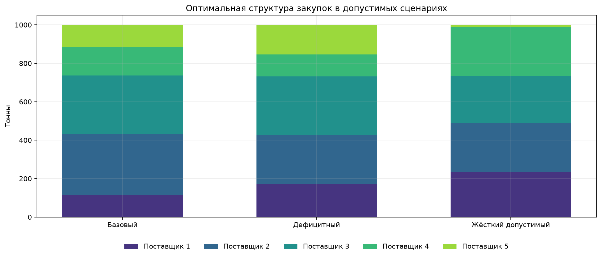

# Лабораторная работа № 1. Вариант 14. Seed 10031

## Постановка
Смешение углей для ТЭС из пяти источников. Минимизируется стоимость закупки C = Σ cᵢxᵢ при Σxᵢ=1000 т, Σaᵢxᵢ≤12,3·1000, Σsᵢxᵢ≤1,25·1000 и 0≤xᵢ≤uᵢ. Зольность и сера заданы в процентах. Объёмы непрерывны.

Множество I = {1,…,5} — поставщики; xᵢ — закупка, т; cᵢ — цена, ₽/т; aᵢ и sᵢ — зольность и содержание серы, %; uᵢ — доступный объём, т. Цель измеряется в рублях, ограничения качества — в %·т. Баланс фиксирует спрос, остальные ограничения задают качество и доступность.

Решатель SciPy linprog / HiGHS, двойственный симплекс highs-ds, presolve включён, допуски прямой и двойственной допустимости 1e-9. Статус optimal означает найденный оптимум с учётом численных допусков; infeasible — отсутствие допустимого решения; unbounded — неограниченность цели; при лимите времени или ошибке оптимальность не подтверждена.

## Происхождение данных
Учебные параметры с seed 10031 сгенерированы программой generate_data.py; методичка не фиксирует численные исходные данные. Входной файл: data/coal_data.json.

## Результаты
```
  Поставщик  Закупка, т  Доступно, т  Использование лимита, %  Цена, ₽/т    Затраты, ₽
Поставщик 1     113.992      243.000                   46.910  5,297.000   603,813.660
Поставщик 2     318.000      318.000                  100.000  4,319.000 1,373,442.000
Поставщик 3     304.000      304.000                  100.000  4,225.000 1,284,400.000
Поставщик 4     147.856      405.000                   36.508  3,854.000   569,836.023
Поставщик 5     116.153      382.000                   30.406  3,137.000   364,370.802
```

Стоимость: 4,195,862.48 ₽; зольность: 12.30000%; сера: 1.25000%.

## Проверка
Максимальное нарушение: 1.137e-13; допустимо: True. Цена пересчитана отдельно: 4,195,862.48 ₽.

## Сценарии
```
          Сценарий     Статус  Стоимость, ₽  Изменение, ₽  Лимит поставщика 2, т  Лимит поставщика 3, т  Лимит зольности, %  Лимит серы, %  Зольность, %  Сера, %  Итерации HiGHS
           Базовый    optimal 4,195,862.485         0.000                318.000                304.000              12.300          1.250        12.300    1.250               4
        Дефицитный    optimal 4,225,215.820    29,353.335                254.400                304.000              12.300          1.250        12.300    1.250               4
        Стрессовый infeasible           NaN           NaN                254.400                243.200              10.500          0.900           NaN      NaN               3
Жёсткий допустимый    optimal 4,395,188.003   199,325.518                254.400                243.200              11.300          1.000        11.300    1.000               4
```

Объёмы закупок по сценариям приведены в [таблице](scenario_plans.csv). В базовом оптимуме задействованы все пять поставщиков. Поставщик № 1 помогает выполнить норматив по зольности, а поставщик № 4 — по сере.



## Теневые оценки
```
       Ограничение  Остаток  Активно  Маржинальная оценка  Выгода от +1 единицы RHS, ₽
   Зольность смеси    0.000     True             -145.831                      145.831
        Сера смеси    0.000     True              -80.303                       80.303
Лимит: Поставщик 1  129.008    False                0.000                       -0.000
Лимит: Поставщик 2    0.000     True             -461.530                      461.530
Лимит: Поставщик 3    0.000     True              -66.865                       66.865
Лимит: Поставщик 4  257.144    False                0.000                       -0.000
Лимит: Поставщик 5  265.847    False                0.000                       -0.000
```

Единицы маржинальных оценок качества — ₽/(%·т), ограничений поставщиков — ₽/т. Приращения неодинаковых единиц нельзя сравнивать напрямую. Для увеличения поставок при прочих равных выгоднее лимит с наибольшей положительной выгодой на тонну; см. таблицу. Теневые цены локальны и могут измениться при смене оптимального базиса.

В первую очередь выгодно расширить лимит поставщика № 2. Дополнительная тонна его угля позволяет сэкономить около 461.53 ₽ при прочих равных.

Проверка локального прогноза (изменение нормы на 0,01 п.п. или лимита на 5 т):
```
               Изменение  Прогноз стоимости, ₽  Фактическая стоимость, ₽  Разница прогноза, ₽
   Зольность: +0,01 п.п.         4,194,404.176             4,194,404.176                0.000
        Сера: +0,01 п.п.         4,195,059.450             4,195,059.450                0.000
Поставщик 2: +5 т лимита         4,193,554.833             4,193,554.833                0.000
```
Для дефицитного сценария также сопоставим прогноз от исходной теневой цены с фактом: прогноз изменения 29,353.33 ₽, фактически 29,353.33 ₽. Отличие возможно при смене базиса; теневая цена гарантирует лишь локальный прогноз.

## Дополнительное задание: сравнение алгоритмов
```
    Метод  Статус  Стоимость, ₽  Итерации  Время, с
 highs-ds optimal 4,195,862.485         4     0.002
highs-ipm optimal 4,195,862.485         7     0.002
```
Время одного запуска зависит от системы и не является устойчивым бенчмарком. Оба метода дали совпадающую целевую функцию; highs-ipm использует метод внутренней точки, highs-ds — двойственный симплекс.

## Выводы
Базовый результат. Оптимальная смесь массой 1,000 т обходится в 4,195,862.48 ₽ (4,195.86 ₽/т). Средняя зольность — 12.300%, сера — 1.250%. Оба норматива качества активны.

Ограниченность поставок. Полностью загружены: Поставщик 2, Поставщик 3. Нулевые закупки: нет. Все положительные закупки могут сосуществовать в оптимуме: даже сравнительно дорогой уголь позволяет разбавлять более загрязнённый дешёвый уголь.

Дефицит. Сокращение мощности поставщика № 2 на 20% приводит к стоимости 4,225,215.82 ₽, что на 29,353.33 ₽ больше базовой. Рост цены обусловлен необходимостью изменить состав смеси, сохранив экологические требования.

При дефиците закупка у поставщика № 2 падает на 63.6 т. Закупки у поставщиков № 1 и № 5 растут на 59.4 и 37.4 т. Первый поставляет уголь с низкой зольностью, пятый — самый дешёвый уголь с высокой зольностью и содержанием серы. Изменение состава позволяет соблюдать оба норматива.

Стресс. Основной стрессовый сценарий имеет статус infeasible. При одновременно заданных сокращениях отгрузки и сере ≤ 0,9% даже минимально достижимая зольность равна 11.707%, то есть выше допустимых 10,5%. Для восстановления допустимости придётся ослабить хотя бы одно условие или найти дополнительные поставки.

Жёсткий, но выполнимый сценарий. При нормативе зольности 11,3% и серы 1,0% стоимость составляет 4,395,188.00 ₽, увеличение относительно базы — 199,325.52 ₽.

Теневые цены. Вблизи базового решения повышение допустимой зольности на 0,01 процентного пункта изменяет стоимость примерно на -1,458.31 ₽; повышение допустимой серы на 0,01 процентного пункта — на -803.03 ₽. Отрицательный знак означает экономию при ослаблении норматива.

Проверка. Все допустимые сценарии повторно проверены кодом NumPy с допуском 10⁻⁷; стоимость в базовом сценарии независимо пересчитана. Найденный план применим как агрегированный план закупки, но для реального ТЭС необходим учёт теплоты сгорания, влажности, логистики, условий контракта, качества партий и целочисленных ограничений перевозки.

## Допущения
Линейное смешивание по массе, фиксированные цены, однородное сырьё, непрерывность закупок. Не учитываются калорийность, влажность, транспорт, потери и сезонность.
