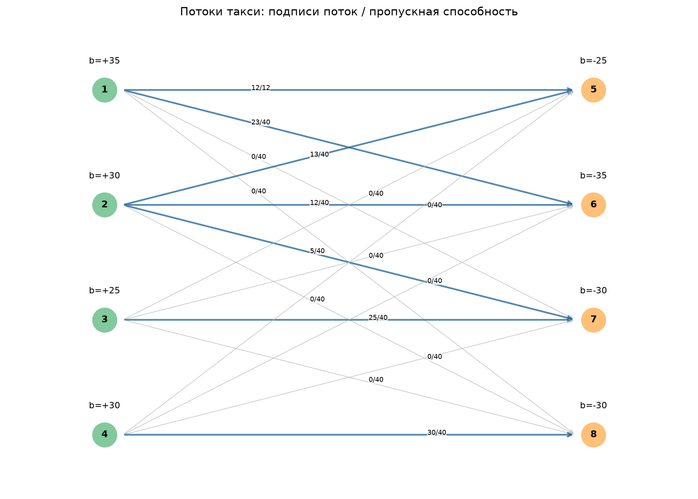

# Лабораторная работа № 2. Вариант 14: балансировка такси

## Постановка и данные
За один период требуется перебросить свободные автомобили из четырёх зон избытка в четыре зоны дефицита. Вершины сети — восемь зон, дуги — допустимые перемещения из зоны избытка в зону дефицита. Исходные данные синтетические, seed 10031; `data/taxi.json` содержит балансы, координаты, стоимости и пропускные способности всех 16 дуг. `generate_data.py` воспроизводит файл. Балансы: [35.0, 30.0, 25.0, 30.0, -25.0, -35.0, -30.0, -30.0]; положительное значение — избыток, отрицательное — потребность. Общий избыток и спрос равны 120 автомобилей.

## Формальная модель
Множество V — зоны 1–8, E — дуги из JSON. xᵢⱼ — непрерывное число автомобилей за период; cᵢⱼ — стоимость перемещения, руб./автомобиль; uᵢⱼ — пропускная способность, автомобилей за период; bᵢ — избыток (положительный) или потребность (отрицательная), автомобилей. Модель минимизирует Σ₍ᵢ,ⱼ₎ cᵢⱼxᵢⱼ при Σⱼ xᵢⱼ − Σⱼ xⱼᵢ = bᵢ для каждой зоны и 0 ≤ xᵢⱼ ≤ uᵢⱼ для каждой дуги. Цель измеряется в рублях за период. Непрерывность — учебное приближение, хотя машины неделимы.

## Решение и проверка
Использован открытый HiGHS через SciPy linprog, highs-ds (двойственный симплекс), presolve включён, допуски солвера 1e-9. Статус optimal означает найденный оптимум с численными допусками; infeasible — система ограничений несовместна, unbounded — цель не ограничена, а достижение лимита или ошибка не подтверждают оптимальность. Базовый статус: optimal, стоимость 1411.00 руб., итераций 6. Таблица потоков и границ: `solution.csv`; схема `network.png` показывает поток/ёмкость на каждой дуге. Затраты указаны в исходном JSON и таблице решения.

Независимый код обходит исходный список дуг, не используя матрицу модели или объект ограничений солвера. Он проверяет баланс в каждой вершине и обе границы каждой дуги, отдельно пересчитывает стоимость. Максимальное нарушение 0 при допуске 1e-7, независимая стоимость 1411.00 руб. Подробности — `verification_nodes.csv`, `solution.csv`, `verification_scenarios.csv`.

## Сценарии


```
                               Сценарий     Статус  Спрос, авто  Запас, авто  Ёмкость выбранной дуги, авто  Стоимость  Изменение стоимости  Итерации
                                Базовый    optimal        120.0        120.0                          40.0     1411.0                  0.0         6
Перегрузка: ёмкость дуги снижена на 50%    optimal        120.0        120.0                          20.0     1461.0                 50.0         7
           Отказ самой загруженной дуги    optimal        120.0        120.0                           0.0     1586.0                175.0         9
                     Рост спроса на 20% infeasible        144.0        120.0                          40.0        NaN                  NaN         7
```
Самая загруженная дуга 4→8 несла 30 автомобилей; при полном отказе стоимость 1586.00, рост 175.00 руб.. При росте спроса на 20% нужно 144 автомобилей при наличии 120; дефицит 24 делает баланс несовместным независимо от пропускных способностей. Это не оценка стоимости неудовлетворённого спроса: модель не допускает недоставки.

Перегрузка смоделирована уменьшением пропускной способности той же дуги на 50%; результаты и планы допустимых сценариев приведены в CSV. Это имитация снижения доступной пропускной способности, а не модель очереди.

## Узкие места и теневые цены
Насыщенные дуги: 1→5 (оценка -7.00 руб./авто). Маржинальная цена — изменение минимальной стоимости в рублях при увеличении ёмкости на один автомобиль локально; отрицательное значение показывает экономию. Насыщенная дуга с нулевой оценкой не обязательно ограничивает стоимость. Повторные решения при увеличении ёмкости на единицу и сравнение с прогнозом сохранены в `shadow_prices.csv`; при смене базиса прогноз может отличаться. Число дуг с нулевым потоком: 9; более дорогие или ненужные перемещения исключаются оптимизатором.

## Сравнение с жадной эвристикой
Эвристика рассматривает дуги по возрастанию стоимости и сразу отправляет максимально возможный поток; результат отдельно проверен. Стоимость 1411.00 руб., относительный зазор к оптимуму 0.00%, максимальная невязка 0; результат в `greedy.csv`. Жадный выбор не гарантирует оптимума, поскольку раннее распределение меняет доступные варианты для остальных зон.

## Дополнительное задание: целочисленная модель
Модель решена повторно через SciPy milp / HiGHS с требованием целочисленности каждого потока. Статус: Optimization terminated successfully. (HiGHS Status 7: Optimal); стоимость 1411.00 руб., отличие от LP 0.00 руб. Независимая проверка ограничений: 0, целочисленности: 0. Сравнение сохранено в `integer_comparison.csv`. Совпадение целей относится к этим данным и не является результатом округления LP-решения.

## Допущения и практическая применимость
План применим как ориентир для короткого периода с известными избытком, спросом и постоянными тарифами. В реальности нужны целочисленные машины, прогнозный и меняющийся спрос, время движения, пробки, отказы водителей и ограничения по времени. Модель не учитывает промежуточные перемещения и неудовлетворённый спрос; оценить устойчивость к ним без расширения модели нельзя.
