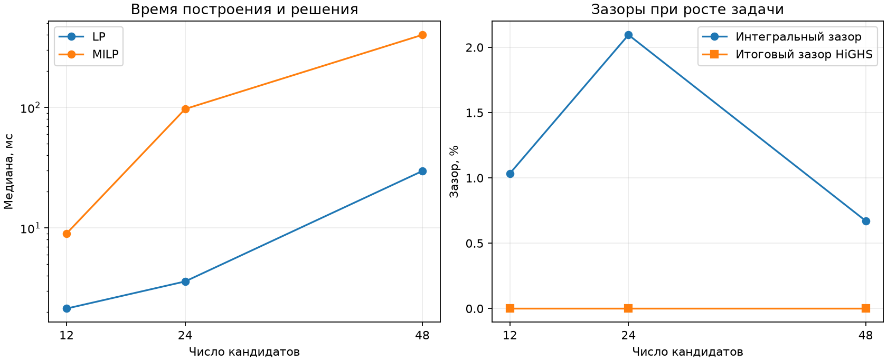

# Лабораторная работа № 3. Формирование проектных команд

Вариант **14**, seed **10031**. Цель работы — сформировать три команды из 12 кандидатов с учётом ролей, совместимости и ограниченного резерва часов, затем оценить цену дискретных решений.

## 1. Исходные данные

В каждой команде нужны разработчик, аналитик и координатор. Числа в столбцах команд — баллы пригодности кандидата для проекта. Часы — вклад кандидата за расчётный период. Командам T01, T02 и T03 требуется соответственно 23, 24 и 25 часов. Каждая может запросить до 10 часов у внешнего специалиста. Открытие резерва стоит 8, 9 или 10 баллов соответственно. Каждый использованный час резерва стоит 2 балла. Баллы пригодности и расходы приведены к одной условной шкале.

| Кандидат | Роль | Часы | T01 | T02 | T03 |
| --- | --- | --- | --- | --- | --- |
| P01 | Разработчик | 5 | 50 | 80 | 71 |
| P02 | Аналитик | 7 | 76 | 77 | 45 |
| P03 | Координатор | 7 | 93 | 74 | 69 |
| P04 | Разработчик | 9 | 80 | 73 | 76 |
| P05 | Аналитик | 10 | 59 | 81 | 68 |
| P06 | Координатор | 7 | 59 | 63 | 70 |
| P07 | Разработчик | 10 | 57 | 67 | 71 |
| P08 | Аналитик | 5 | 74 | 68 | 82 |
| P09 | Координатор | 5 | 49 | 65 | 68 |
| P10 | Разработчик | 5 | 54 | 72 | 81 |
| P11 | Аналитик | 8 | 64 | 53 | 65 |
| P12 | Координатор | 10 | 78 | 80 | 83 |

Несовместимые пары в базе — P01/P08, P03/P11, P05/P07, P05/P12, P06/P11. Их нельзя назначать в одну команду. Данные синтетические и хранятся отдельно от модели в [JSON](../data/teams_12.json). Генератор создаёт оценки, часы и пары по фиксированному seed. Параметры команд и правила сценариев заданы в генераторе.

## 2. Формальная MILP-модель

- $I$ — кандидаты, $J$ — команды, $R$ — роли, $I_r$ — кандидаты роли $r$, $F$ — несовместимые пары.
- $s_{ij}$ — оценка назначения в баллах, $a_i$ — часы кандидата, $D_j$ — потребность команды в часах, $H_j$ — лимит внешнего резерва в часах, $u_i$ — доступность кандидата (0 или 1).
- $f_j$ — фиксированная плата за открытие резерва в баллах, $c_j$ — плата в баллах за час.
- $x_{ij}$ — бинарное назначение кандидата в команду. $y_j$ — бинарное включение резерва. $h_j$ — непрерывные часы внешней поддержки.

Максимизируется итоговая оценка в баллах.

$$
Z=\sum_{i\in I,j\in J} s_{ij}x_{ij}-\sum_{j\in J}(f_jy_j+c_jh_j).
$$

| Ограничение | Смысл |
| --- | --- |
| $\sum_{j\in J}x_{ij}\le1$ для $i\in I$ | Кандидат участвует максимум в одной команде |
| $x_{ij}\le u_i$ для $i\in I,j\in J$ | Недоступных кандидатов нельзя назначать |
| $\sum_{i\in I_r}x_{ij}=1$ для $r\in R,j\in J$ | Ровно один человек на каждую роль |
| $x_{ij}+x_{kj}\le1$ для $(i,k)\in F,j\in J$ | Несовместимая пара не работает в одной команде |
| $\sum_{i\in I}a_ix_{ij}+h_j\ge D_j$ для $j\in J$ | Покрыть потребность команды в часах |
| $0\le h_j\le H_j$ и $h_j\le M_j y_j$ для $j\in J$ | Соблюсти лимит и разрешить часы только при активации |

$x_{ij},y_j\in\{0,1\}$, $h_j\in\mathbb{R}$. Неделимость назначения и однократная фиксированная плата при любом положительном объёме поддержки требуют дискретных решений. В LP-релаксации $x_{ij}$ и $y_j$ ограничены от 0 до 1, остальные ограничения сохранены.

## 3. Решатель, решения и проверка

LP решена двойственным симплекс-методом HiGHS через `scipy.optimize.linprog` (`highs-ds`). MILP решена через `scipy.optimize.milp` с ветвлением и отсечениями HiGHS. В обоих случаях включён presolve и задан предел 15 секунд на solve. Для MILP задан `mip_rel_gap=0`. Интерфейс SciPy минимизирует, поэтому код передаёт $-Z$ и меняет знак результата и двойственной границы при выводе. Версии зафиксированы в [README](../README.md) и [requirements.txt](../requirements.txt), нативные протоколы находятся в [solver.log](solver.log).

Статус `optimal` означает, что решатель подтвердил оптимальность в численных допусках. Статус `infeasible` означает несовместность требований. `unbounded` означает, что цель не ограничена. При достижении лимита оптимальность может остаться недоказанной.

| Сценарий | Недоступны | Новая несовместимая пара | Доп. часы на команду | Статус | Оценка, баллы | Изменение | Верхняя граница | Зазор HiGHS, % |
| --- | --- | --- | --- | --- | --- | --- | --- | --- |
| Базовый | — | — | 0 | optimal | 696.00 | +0.00 | 696.00 | 0.00 |
| Дефицитный | P01 | — | 0 | optimal | 688.00 | -8.00 | 688.00 | 0.00 |
| Стрессовый | P01, P06 | P02/P04 | 1 | optimal | 658.00 | -38.00 | 658.00 | 0.00 |

| Сценарий и метод | Команда | Назначения | Свои часы | Требуется | Резерв, ч | Активация | Оценка до расходов | Расходы, баллы |
| --- | --- | --- | --- | --- | --- | --- | --- | --- |
| Базовый / LP | T01 | P02, P03, P04 | 23.00 | 23 | 0.00 | -0 | 249.00 | 0.00 |
| Базовый / LP | T02 | P01, P05, P06 | 22.00 | 24 | 2.00 | 0.2 | 224.00 | 5.80 |
| Базовый / LP | T03 | P07, P08, P12 | 25.00 | 25 | 0.00 | -0 | 236.00 | 0.00 |
| Базовый / MILP | T01 | P02, P03, P04 | 23.00 | 23 | 0.00 | -0 | 249.00 | 0.00 |
| Базовый / MILP | T02 | P01, P05, P06 | 22.00 | 24 | 2.00 | 1 | 224.00 | 13.00 |
| Базовый / MILP | T03 | P07, P08, P12 | 25.00 | 25 | 0.00 | -0 | 236.00 | 0.00 |
| Дефицитный / MILP | T01 | P02, P03, P04 | 23.00 | 23 | 0.00 | -0 | 249.00 | 0.00 |
| Дефицитный / MILP | T02 | P05, P06, P10 | 22.00 | 24 | 2.00 | 1 | 216.00 | 13.00 |
| Дефицитный / MILP | T03 | P07, P08, P12 | 25.00 | 25 | -0.00 | -0 | 236.00 | -0.00 |
| Стрессовый / MILP | T01 | P02, P03, P07 | 24.00 | 24 | -0.00 | -0 | 226.00 | -0.00 |
| Стрессовый / MILP | T02 | P04, P05, P09 | 24.00 | 25 | 1.00 | 1 | 219.00 | 11.00 |
| Стрессовый / MILP | T03 | P08, P10, P12 | 20.00 | 26 | 6.00 | 1 | 246.00 | 22.00 |

Базовая LP дала **703.20 балла**, MILP — **696.00 балла**. Интегральный зазор равен $(Z_{LP}-Z_{MILP})/|Z_{MILP}|$ и составляет **1.034%**. LP назначила тех же людей, но для двух часов резерва T02 выбрала $y_{T02}=0.2$ и списала лишь 1,8 из 9 баллов фиксированной платы. При целочисленном включении команда платит все 9 баллов. Итоговый зазор ветвления HiGHS — другой показатель. Он сравнивает лучшее найденное целочисленное решение с глобальной границей поиска. В базе он равен **0.00%**, поскольку обе оценки равны 696.

Независимый проверяющий код проходит по кандидатам, ролям и парам из исходных данных. Он проверяет назначения, доступность, бинарность, часы, границы и связки big-M с абсолютным допуском $10^{-7}$. Цель пересчитывается отдельно по баллам и расходам. Полная детализация сохранена в [verification_details.csv](verification_details.csv).

| Сценарий | Метод | Независимая оценка | Расхождение цели | Максимальное нарушение |
| --- | --- | --- | --- | --- |
| Базовый | LP | 703.20 | 0.00e+00 | 0.00e+00 |
| Базовый | MILP | 696.00 | 0.00e+00 | 0.00e+00 |
| Базовый | greedy | 667.00 | — | 0.00e+00 |
| Дефицитный | MILP | 688.00 | 0.00e+00 | 0.00e+00 |
| Дефицитный | greedy | 667.00 | — | 0.00e+00 |
| Стрессовый | MILP | 658.00 | 0.00e+00 | 0.00e+00 |
| Стрессовый | greedy | 652.00 | — | 0.00e+00 |

## 4. Сценарии и эвристика

При отсутствии P01 команда T02 назначает P10 на роль разработчика и сохраняет два часа резерва. Оценка снижается с 696 до 688 баллов. В стрессе дополнительно недоступен P06, пара P02/P04 становится несовместимой, а каждой команде требуется на час больше. Меняются все три состава, кандидат P04 переходит в T02, а T03 запрашивает шесть часов резерва. Оценка падает до 658 баллов.

Жадная эвристика проходит команды в порядке T01, T02, T03. Для текущей команды она выбирает совместимую тройку с максимальной локальной оценкой после оплаты резерва. Уже назначенные кандидаты исключаются. Эвристика работает на тех же данных и проверяется тем же независимым кодом. Потеря рассчитывается как $(Z_{MILP}-Z_{greedy})/|Z_{MILP}|$.

| Сценарий | Статус эвристики | MILP, баллы | Эвристика, баллы | Потеря, % | MILP, мс | Эвристика, мс |
| --- | --- | --- | --- | --- | --- | --- |
| Базовый | feasible | 696.00 | 667.00 | 4.17 | 9.577 | 0.497 |
| Дефицитный | feasible | 688.00 | 667.00 | 3.05 | 9.177 | 0.404 |
| Стрессовый | feasible | 658.00 | 652.00 | 0.91 | 10.976 | 0.288 |

В базе локальный выбор для T01 ограничивает последующие назначения. Наилучший состав каждой очередной команды не гарантирует максимальную оценку проекта.

## 5. Выбор big-M и дополнительная формулировка

Из ограничения $h_j\le H_j=10$ следует, что достаточно $M_j=10$ часов. Когда резерв включён, связка не ограничивает доступный объём сверх исходного лимита. Когда выключен, она запрещает внешние часы. Для опыта с $M_j=1000$ физическая граница $h_j\le10$ сохранена, поэтому допустимые целочисленные решения те же. Релаксация оплачивает лишь 0.002 фиксированной платы T02 при тех же двух часах, и верхняя граница ухудшается с 703.200 до 704.982 балла. Отдельные замеры небольшой задачи не позволяют сделать общий вывод о влиянии M на время.

В усиленной формулировке для каждой совместимой тройки $S$, собственных часов которой недостаточно команде $j$, добавлено неравенство $\sum_{i\in S}x_{ij}\le 2+y_j$. Если назначены все трое, оно требует включить резерв. Это уже следует из исходной MILP. Если выбраны максимум двое из тройки, неравенство выполняется автоматически. Следовательно, отсечения сохраняют целочисленные планы. На этом наборе они уменьшают верхнюю границу LP до 699.700 балла при том же MILP-оптимуме 696.

| Формулировка | M, ч | LP, баллы | MILP, баллы | Интегральный зазор, % | Узлы MILP | Медиана MILP, мс | y для T02 в LP |
| --- | --- | --- | --- | --- | --- | --- | --- |
| Обоснованное M | 10 | 703.200 | 696.00 | 1.034 | 1 | 9.575 | 0.2000 |
| Завышенное M | 1000 | 704.982 | 696.00 | 1.291 | 1 | 9.387 | 0.0020 |
| Обоснованное M с отсечениями | 10 | 699.700 | 696.00 | 0.532 | 1 | 11.271 | 0.3000 |

## 6. Рост масштаба

Сравниваются три отдельно сгенерированных набора на 12, 24 и 48 кандидатов с пропорционально растущим числом команд. Для каждого размера решены LP и MILP. Медиана получена по 5 запускам без печати журнала и включает построение модели и вызов решателя. Использован тот же способ измерения для сравнения формулировок и эвристики. Нативный журнал записан отдельным запуском. Абсолютное время зависит от компьютера, а три реализации данных не дают гарантии монотонности зазора.

| Кандидаты | Команды | Бинарные | Непрерывные | LP, баллы | MILP, баллы | LP, мс | MILP, мс | Интегральный зазор, % | Зазор HiGHS, % | Узлы MILP |
| --- | --- | --- | --- | --- | --- | --- | --- | --- | --- | --- |
| 12 | 3 | 39 | 3 | 703.20 | 696.00 | 2.146 | 8.995 | 1.034 | 0.00 | 1 |
| 24 | 6 | 150 | 6 | 1401.77 | 1373.00 | 3.602 | 97.091 | 2.095 | 0.00 | 0 |
| 48 | 12 | 588 | 12 | 2936.58 | 2917.00 | 29.673 | 399.959 | 0.671 | 0.00 | 1 |

Рост числа команд и кандидатов увеличивает число бинарных назначений. Во всех трёх наборах HiGHS подтвердил оптимальность. Ненулевой интегральный зазор показывает разницу с полной LP-релаксацией даже при нулевом итоговом зазоре ветвления.

## 7. Практическая применимость

Базовый состав реализуем в рамках заданных ролей, часов и парных ограничений. Он требует заранее подтвердить два часа внешней поддержки для T02. Для реального проекта потребуются проверка оценок пригодности, календарей, бюджета и наличия внешних специалистов. Модель предполагает фиксированные роли, общий расчётный период и отдельный лимит внешних часов для каждой команды. Синтетические баллы подходят для сравнения планов внутри эксперимента.
